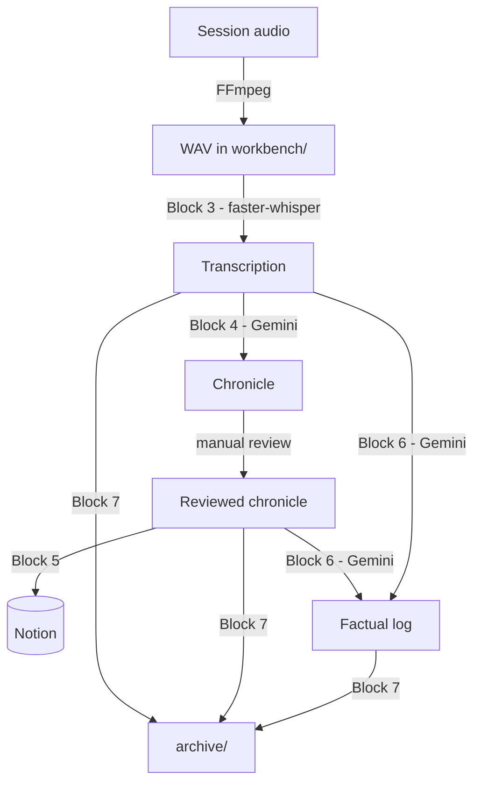

# RPG Transcription & Chronicle Generator

[Versão em português](README.md)

A pipeline that turns the recording of a tabletop RPG session into organized campaign material: audio **transcription** with [faster-whisper](https://github.com/SYSTRAN/faster-whisper), a narrative **chronicle** and a structured **factual log** generated with the Gemini API, and **optional publishing to Notion**. Everything runs in Google Colab notebooks (free T4 GPU) and stores its files in Google Drive.

It was built for game masters who record their sessions and want, for each campaign, a readable summary (the chronicle) and a detailed reference base (the logs), at no infrastructure cost.

> **Note on language.** The prompts, glossaries, generated files, log messages and Notion property names are in Brazilian Portuguese, and the pipeline transcribes audio in Portuguese (`language="pt"`). Names such as `_cronica.md` or `Sessão` are quoted exactly as they appear in the project.

---

## Pipeline overview



| Notebook | Purpose |
|---|---|
| `notebooks/session_pipeline.ipynb` | Full pipeline for **a single session**, block by block (Blocks 1 to 7). |
| `notebooks/backlog_notion.ipynb` | Publishes the chronicles of older sessions to Notion **in batch**. |
| `notebooks/backlog_logs.ipynb` | Generates the logs **in batch** for older sessions that already have a chronicle and a transcription. |

---

## Prerequisites

- **A Google account**, for Colab (free T4 GPU) and Drive.
- **A Gemini API key** (the Free Tier is enough, but it has usage limits; see [Limits and troubleshooting](#limits-and-troubleshooting)).
- **A Notion integration** (optional): only needed to publish chronicles to Notion. Tables without Notion use the pipeline normally and skip Block 5.
- **FFmpeg** installed on your computer, to convert and split audio files before uploading them to Drive.

---

## Initial setup (done once)

### 1. Open the notebooks in Colab
In Colab, use **File > Open notebook > GitHub** and enter the repository. The notebooks clone this repository by themselves on the first run.

### 2. Folder structure in Drive
Create the `rpg-transcription` folder at the root of your Drive (`MyDrive/rpg-transcription`; the path is set in the `PROJECT_FOLDER` variable of the notebooks). The pipeline uses this structure and creates the `archive/` folders as needed:

```
rpg-transcription/
├── config/                       notion_config.json
├── workbench/                    working area: audio, transcription, chronicle and log under review
└── archive/
    ├── chronicles/<MESA>/        archived chronicles
    ├── logs/<MESA>/              individual + consolidated logs
    └── transcriptions/<MESA>/    archived final transcriptions
```

In the single-session flow, `workbench/` is the only folder the pipeline writes to while processing (the `backlog_logs` notebook is the exception: it writes straight to `archive/logs/<MESA>/`). Everything in `workbench/` is disposable once archived, which is why the configuration files and the archive live in separate folders.

> `<MESA>` is the **table code** (the campaign's short identifier, for example `ABC`). Codes are case sensitive: `ABC` and `Abc` are different tables and produce different folders.

### 3. Colab Secrets
In Colab, open the **Secrets** panel (key icon) and add the following, enabling notebook access:

| Secret | Use |
|---|---|
| `GEMINI_API_KEY` | Required. Chronicle and log generation. Read in Block 2 and used by Blocks 4 and 6. |
| `NOTION_TOKEN` | Only if you publish to Notion. |

### 4. Notion integration (optional)
1. Create an internal integration in Notion and copy its token into the `NOTION_TOKEN` secret.
2. Connect the integration to the databases you will use (database menu > Connections).
3. Make sure the databases have the properties below. Names and types must match exactly (the names are in Portuguese, as the code expects):

| Database | Property | Type |
|---|---|---|
| Sessions | `Nome` (name) | Title |
| Sessions | `Título` (title) | Text |
| Sessions | `Sessão` (session) | Number |
| Sessions | `Data` (date) | Date |
| Sessions | `NPCs` | Relation (to the NPC database) |
| Sessions | `Campanha` (campaign) | Text (required if the table uses `DB_CAMPAIGN`) |
| NPCs | `Nome` (name) | Title |

4. Create the file `config/notion_config.json` in Drive (not in the repository), with one entry per table:

```json
{
  "ABC": {
    "DB_SESSAO": "<sessions database id>",
    "DB_NPCS": "<NPC database id>",
    "DB_CAMPAIGN": "<campaign name>"
  }
}
```

A database id is the 32-character code that appears in its URL. **This file contains identifiers from your workspace: never commit it.**

How each field works:

- `DB_SESSAO` and `DB_NPCS`: the table's sessions and NPC databases. They can be **dedicated to one campaign** or **shared by several**.
- `DB_CAMPAIGN`: the campaign name. It is written to the `Campanha` property of each session and used as a filter in queries (for example, so the backlog notebooks can find which sessions already exist). It is optional for a dedicated database, but **must be set when the database is shared**; without it, sessions from different campaigns get mixed up in the existence check.
- The NPC database is queried only by the `Nome` property, with no campaign filter. In a shared NPC database, an NPC with the same name in two campaigns points to the same page.
- The table code must be **identical** to the `ID_MESA` used in the notebooks.

### 5. Registering a new table
1. Pick a code (letters only, case sensitive) and use it as `ID_MESA`.
2. Create the table's glossary at `lore/glossary_<code in lowercase>.md` and register it in `TABLE_CONFIG`, in `utils/glossary_manager.py`.
3. If the table uses Notion, add its entry to `config/notion_config.json`.

**Glossaries.** There is a general glossary (`lore/glossary.md`) and one per table. The listed names serve two purposes: they guide Whisper (`initial_prompt`) and they are the spelling reference Gemini uses to correct names in the chronicle and the log. Keep the section titles the prompts expect, especially `# Nomes de personagens de jogadores` (player character names) and `# Nomes de outros personagens` (other characters' names): the log uses the first one to list the player characters, always in glossary order.

> The glossary lookup lowercases the table code, but the folders and `notion_config.json` do not. If you type `Abc` instead of `ABC`, the glossary is still found and a new folder is created. That is why Block 7 warns whenever a table folder is created.

### 6. Model and prompt configuration
- `config/gemini_config.json` (in the repository) defines the model queue, the output token limit, the error codes that trigger the next model in the queue (fallback) and the sampling parameters. To test a specific model, use `MODEL_OVERRIDE` (in the editable area of Block 2 in `session_pipeline.ipynb` and in the first cell of `backlog_logs.ipynb`); leave it as `None` to use the default queue.
- The **prompts** (`prompts/`) and **glossaries** (`lore/`) are downloaded from the `main` branch on GitHub on every run: changes only take effect after you push.
- If you use a fork, you must change the repository address in these places: `BASE_URL` in `utils/glossary_manager.py`; the prompt URL in `src/chronicler.py` and `src/session_logger.py`; and the `git clone` in Block 2 of `session_pipeline.ipynb`, in Block 2 of `backlog_notion.ipynb` and in the first cell of `backlog_logs.ipynb`.

---

## Audio preparation (FFmpeg)

Whisper works best with 16 kHz mono `.wav` files. Convert the recording before uploading it to Drive. The file name is `<CODE><NUMBER>`, matching the notebook's `ID_MESA` + `SESSION_NUMBER` (for example, `ABC001`). The examples use `.mp3`; adjust the extension as needed.

**Audio longer than 120 minutes must be split into 120-minute parts.** The free Colab tier often fails when transcribing very long audio.

### Single file (up to 120 minutes)

**Git Bash:**
```bash
cd "<PATH_TO_THE_FILE_FOLDER>"
NOME="ABC001"; ffmpeg -i "$NOME.mp3" -ac 1 -ar 16000 -c:a pcm_s16le "${NOME}w.wav"
```

**PowerShell:**
```PowerShell
cd "<PATH_TO_THE_FILE_FOLDER>"
$nome = "ABC001"; ffmpeg -i "$nome.mp3" -ac 1 -ar 16000 -c:a pcm_s16le "$($nome)w.wav"
```

### Several files at once

**Git Bash:**
```bash
cd "<PATH_TO_THE_FILES_FOLDER>"
for f in *.mp3; do ffmpeg -i "$f" -ac 1 -ar 16000 -c:a pcm_s16le "${f%.mp3}w.wav"; done
```

**PowerShell:**
```PowerShell
cd "<PATH_TO_THE_FILES_FOLDER>"
Get-ChildItem *.mp3 | ForEach-Object { ffmpeg -i $_.Name -ac 1 -ar 16000 -c:a pcm_s16le "$($_.BaseName)w.wav" }
```

### Long file, split into 120-minute parts

**Git Bash:**
```bash
cd "<PATH_TO_THE_FILE_FOLDER>"
NOME="ABC001"; ffmpeg -i "$NOME.mp3" -f segment -segment_time 02:00:00 -ac 1 -ar 16000 -c:a pcm_s16le "${NOME}_parte_%03d.wav"
```

**PowerShell:**
```PowerShell
cd "<PATH_TO_THE_FILE_FOLDER>"
$nome = "ABC001"; ffmpeg -i "$nome.mp3" -f segment -segment_time 02:00:00 -ac 1 -ar 16000 -c:a pcm_s16le "$($nome)_parte_%03d.wav"
```

This produces `ABC001_parte_000.wav`, `ABC001_parte_001.wav` and so on. Block 3 detects the parts by itself: each one is transcribed (parts that already have a transcription are skipped) and the texts are joined, in order, into a single file.

### Upload to Drive
Copy the `.wav` (or the parts) to `rpg-transcription/workbench/`.

---

## Usage: a single session (`session_pipeline.ipynb`)

Before starting, enable the GPU: **Runtime > Change runtime type > T4 GPU**. Transcription runs on GPU only; without one, the code stops with an error message.

| Block | What it does | What you edit |
|---|---|---|
| 1 | Installs the dependencies. Run once per runtime; no session restart is needed. | Nothing. |
| 2 | Mounts Drive, reads the `GEMINI_API_KEY` secret, clones the repository and loads the glossary and the session paths. | `ID_MESA`, `SESSION_NUMBER` (e.g. `"001"`), `SESSION_DATE` (`YYYY-MM-DD`), `FORCE_UPDATE` (`True` to pull repository changes), `MODEL_OVERRIDE` (`None` uses the default queue; applies to Blocks 4 and 6). |
| 3 | Transcribes the audio (single file or parts). | Optionally `model_precision` and `model_name`. |
| 4 | Generates the chronicle with Gemini. | `TEMPLATE`: `template_chronicle_v1` for regular sessions, `template_session0_v1` for Session 0. |
| 5 | Publishes the chronicle to Notion, also creating the NPC pages. **Skip it if the table does not use Notion.** | Nothing. |
| 6 | Generates the session's factual log in `workbench/`, from the transcription, the reviewed chronicle and the glossary. Uses `SESSION_DATE` as the session date. | Nothing. |
| 7 | Archives the session and updates the consolidated logs (see below). | Nothing. |

**Review before publishing and generating the log.** After Block 4, read and correct the chronicle in `workbench/`. Block 6 treats the reviewed chronicle as the reference for spelling and facts, so it is worth reviewing it before Blocks 5 and 6. When reviewing, keep the first line as the title (`# ...`) and the list under "NPCs encontrados" (NPCs met): Block 5 uses the first line as the session title and creates one NPC page for each item in that list.

**Block 6 (log).** The log is a factual record with seven sections: timeline and group decisions; inventory, resources and economy; clues and revealed mechanics; loose ends and active threats; companion NPCs; engagement of each player character; and behind-the-scenes notes and future planning. The raw transcription is the source for amounts, quantities and quotes; the glossary and the reviewed chronicle define how names are spelled. The log is not consolidated at this stage: that happens in Block 7.

**Block 7 (archive).** Moves, rather than copies, the final transcription, the chronicle and the log from `workbench/` to the table's folders in `archive/`, and rebuilds the consolidated logs. If any destination file already exists, it **moves nothing** and lists the conflicts. If a table folder gets created, it warns you, which helps catch mistyped table codes. Any audio files and parts left in `workbench/` are for you to delete manually.

**Cautions when re-running blocks**
- Blocks 3, 4 and 6 **overwrite** their output without asking. Running Block 4 again erases the chronicle you reviewed. Block 3 resumes per part: parts that were already transcribed are skipped.
- Block 5 does not check whether the session already exists in Notion: running it twice creates a duplicate page.
- Blocks 4 and 6 do not depend on each other: both use `GEMINI_API_KEY` and `MODEL_OVERRIDE`, defined in Block 2. If the runtime restarts after you review the chronicle, run Blocks 1 and 2 and go straight to Block 6, **without running Block 4**, which would overwrite the reviewed chronicle.
- After Block 7, the session's files leave `workbench/`. To reprocess an already archived session, move the files back to `workbench/` and resolve any conflicts before archiving again.

---

## Usage: older sessions (backlog)

For campaigns that already have chronicles and transcriptions stored in `archive/`:

- **`backlog_notion.ipynb`** reads the chronicles from `archive/chronicles/<MESA>/` and publishes to Notion the ones that are not there yet (sessions already registered are skipped, never overwritten). Every published session gets the `DEFAULT_DATE` date. If the Notion query fails, nothing is published.
- **`backlog_logs.ipynb`** reads the chronicles and transcriptions from `archive/` and writes the logs directly to `archive/logs/<MESA>/`. With `OVERWRITE_EXISTING = False`, sessions that already have a log are skipped, which acts as a resume point. Dates come from Notion; if the session is not there, the file's date is used. `MAX_SESSIONS_PER_RUN` and `SLEEP_SECONDS` control the pace to respect Free Tier limits. At the end, the consolidated logs are updated.

### Migrating files from the old structure
If you already have chronicles and transcriptions loose in the project root or in the `Crônicas e Transcrições` folder, you can move them to the current structure once, with `migrate_legacy_files` (in `src/session_archiver.py`). **Dry run is the default**: it only lists what would be moved, by destination folder, and points out conflicts.

```python
from src.session_archiver import migrate_legacy_files

migrate_legacy_files(PROJECT_FOLDER, dry_run=True)   # only lists
migrate_legacy_files(PROJECT_FOLDER, dry_run=False)  # actually moves
```

---

## Generated files

`<ID>` is the table code plus the session number (for example, `ABC001`).

| File | Generated by | Where it lives |
|---|---|---|
| `<ID>w.wav` or `<ID>_parte_NNN.wav` | FFmpeg | `workbench/` (delete manually) |
| `<ID>_transcricao_final_parte_NNN.txt` | Block 3 (one per part; enables resuming) | `workbench/` |
| `<ID>_transcricao_final.txt` | Block 3 | `workbench/`, then `archive/transcriptions/<MESA>/` |
| `<ID>_cronica.md` | Block 4 | `workbench/`, then `archive/chronicles/<MESA>/` |
| `<ID>_log.md` | Block 6 | `workbench/`, then `archive/logs/<MESA>/` |
| `<MESA>_Logs_Consolidados_Parte_X.md` | Block 7 and `backlog_logs` | `archive/logs/<MESA>/` |

The consolidated logs group 20 sessions per file (Part 1: sessions 1 to 20; Part 2: 21 to 40; and so on), intended to be uploaded as a source to a document-querying tool.

## Repository structure

```
rpg_transcription/
├── config/        gemini_config.json (model queue, limits and fallback)
├── lore/          glossary.md (general) and glossary_<code>.md (per table)
├── notebooks/     session_pipeline, backlog_notion, backlog_logs
├── prompts/       prompt templates for the chronicle, Session 0 and the log
├── src/           transcription, chronicle, log, archiving and batch publishing
├── utils/         glossary, session paths, Notion and CUDA libraries
└── requirements.txt
```

`requirements.txt` lists the dependencies for anyone running outside Colab. In Colab, Block 1 installs them.

---

## Limits and troubleshooting

**Free-tier limits**
- Free Colab may run out of available GPUs at peak times; just try again later.
- Audio longer than 120 minutes must be split into parts (see audio preparation).
- The Gemini Free Tier limits requests per minute and per day. `backlog_logs` assumes about 5 per minute and 20 per day; check your account's current limits.

The messages below are printed by the code in Portuguese; the English gloss is in parentheses.

| Symptom | Likely cause and what to do |
|---|---|
| "Nenhuma GPU CUDA detectada" (no CUDA GPU detected) | Enable the T4 GPU in the runtime type and run the blocks again. |
| `TypeError` mentioning `metadata_errors` | Incompatible PyAV version. Block 1 already installs `av<19`; run it again. |
| Warning that `nvidia-cublas-cu12` / `nvidia-cudnn-cu12` packages were not found | Run Block 1 (installation) before Block 3. |
| Colab crashes or fails on a long audio file | Split the audio into 120-minute parts. When you run Block 3 again, parts that were already transcribed are skipped. |
| "Cota excedida ... Tentando fallback" (quota exceeded, trying fallback; error 429 or 503) | Expected on the Free Tier: the code moves to the next model in the queue. If all fail, wait (it may be the daily limit) and run again; the backlog resumes where it stopped. |
| "Secret 'GEMINI_API_KEY' não encontrado" (secret not found) | Add the secret in Colab's Secrets panel, enable notebook access and run Block 2 again. |
| "Erro ao baixar o prompt" (error downloading the prompt) | The template name does not exist on the `main` branch, or GitHub is unavailable. |
| "Mesa '...' não encontrada" (table not found) | The code differs from the one in `notion_config.json` (case matters), or the table does not use Notion; in that case, skip Block 5. |
| An unexpected "Pasta NOVA criada" (new folder created) warning | The table code was typed differently from before. Move the files and fix `ID_MESA`. |
| "Arquivamento cancelado" (archiving cancelled) in Block 7 | A file with the same name already exists at the destination. Nothing was moved; check before repeating. |
| Strange library errors | Use **Runtime > Disconnect and delete runtime** and start again from Block 1. |

> Do not install `numpy`, `torch` or `WhisperX` manually: Colab already provides what is needed and these packages conflict. `av` has a version ceiling (`av<19`) due to an incompatibility with faster-whisper 1.2.1; the reason is commented in Block 1.

---

## Contributing

Questions, problems and suggestions can be filed as issues in this repository.

## License

This repository does not define a license yet.