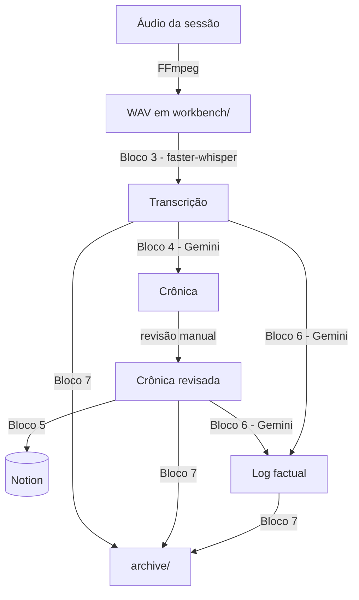

# RPG Transcription & Chronicle Generator

[English version](README.en.md)

Pipeline que transforma a gravação de uma sessão de RPG de mesa em material de campanha organizado: **transcrição** do áudio com [faster-whisper](https://github.com/SYSTRAN/faster-whisper), **crônica** narrativa e **log factual** gerados com a Gemini API, e **publicação opcional no Notion**. Tudo roda em notebooks do Google Colab (GPU T4 gratuita) e guarda os arquivos no Google Drive.

Foi pensado para mestres que gravam as sessões e querem manter, para cada campanha, um resumo legível (a crônica) e uma base detalhada para consulta (os logs), sem custo de infraestrutura.

---

## Visão geral do pipeline



| Notebook | Para que serve |
|---|---|
| `notebooks/transcritor_rpg.ipynb` | Pipeline completo de **uma sessão**, bloco a bloco (Blocos 1 a 7). |
| `notebooks/backlog_notion.ipynb` | Publica no Notion, **em lote**, as crônicas de sessões antigas. |
| `notebooks/backlog_logs.ipynb` | Gera os logs, **em lote**, das sessões antigas que já têm crônica e transcrição. |

---

## Pré-requisitos

- **Conta Google**, para o Colab (GPU T4 gratuita) e o Drive.
- **Chave da Gemini API** (o Free Tier basta, mas tem limites de uso; veja [Limites e solução de problemas](#limites-e-solução-de-problemas)).
- **Integração do Notion** (opcional): só é necessária para publicar crônicas no Notion. Mesas sem Notion usam o pipeline normalmente, pulando o Bloco 5.
- **FFmpeg** instalado no seu computador, para converter e dividir os áudios antes de enviá-los ao Drive.

---

## Configuração inicial (feita uma vez)

### 1. Abrir os notebooks no Colab
No Colab, use **Arquivo > Abrir notebook > GitHub** e informe o repositório. Os notebooks clonam este repositório sozinhos na primeira execução.

### 2. Estrutura de pastas no Drive
Crie a pasta `rpg-transcription` na raiz do seu Drive (`MyDrive/rpg-transcription`; o caminho está na variável `PROJECT_FOLDER` dos notebooks). O pipeline usa esta estrutura e cria as pastas de `archive/` conforme precisa:

```
rpg-transcription/
├── config/                       notion_config.json
├── workbench/                    área de trabalho: áudios, transcrição, crônica e log em revisão
└── archive/
    ├── chronicles/<MESA>/        crônicas arquivadas
    ├── logs/<MESA>/              logs individuais + consolidados
    └── transcriptions/<MESA>/    transcrições finais arquivadas
```

A pasta `workbench/` é a única em que o pipeline escreve durante o processamento. Tudo o que está nela é descartável depois de arquivar; por isso os arquivos de configuração e o arquivo morto ficam em pastas separadas.

> `<MESA>` é a **sigla da mesa** (por exemplo, `ABC`). As siglas diferenciam maiúsculas de minúsculas: `ABC` e `Abc` são mesas diferentes e geram pastas diferentes.

### 3. Secrets do Colab
No Colab, abra o painel de **Secrets** (ícone de chave) e cadastre, liberando o acesso para o notebook:

| Secret | Uso |
|---|---|
| `GEMINI_API_KEY` | Obrigatório. Geração de crônicas e logs. Lido no Bloco 2 e usado pelos Blocos 4 e 6. |
| `NOTION_TOKEN` | Só se for publicar no Notion. |

### 4. Integração com o Notion (opcional)
1. Crie uma integração interna no Notion e copie o token para o secret `NOTION_TOKEN`.
2. Conecte a integração aos databases que serão usados (menu do database > Conexões).
3. Garanta que os databases tenham as propriedades abaixo. Os nomes e tipos precisam ser exatamente estes:

| Database | Propriedade | Tipo |
|---|---|---|
| Sessões | `Nome` | Título |
| Sessões | `Título` | Texto |
| Sessões | `Sessão` | Número |
| Sessões | `Data` | Data |
| Sessões | `NPCs` | Relação (com o database de NPCs) |
| Sessões | `Campanha` | Texto (obrigatória se a mesa usar `DB_CAMPAIGN`) |
| NPCs | `Nome` | Título |

4. Crie o arquivo `config/notion_config.json` no Drive (não no repositório), com uma entrada por mesa:

```json
{
  "ABC": {
    "DB_SESSAO": "<id do database de sessões>",
    "DB_NPCS": "<id do database de NPCs>",
    "DB_CAMPAIGN": "<nome da campanha>"
  }
}
```

O id de um database é o código de 32 caracteres que aparece na URL dele. **Esse arquivo contém identificadores do seu workspace: nunca o versione.**

Como cada campo funciona:

- `DB_SESSAO` e `DB_NPCS`: databases de sessões e de NPCs da mesa. Podem ser **exclusivos de uma campanha** ou **compartilhados por várias**.
- `DB_CAMPAIGN`: nome da campanha, gravado na propriedade `Campanha` de cada sessão e usado como filtro nas consultas (por exemplo, para os notebooks de backlog descobrirem quais sessões já existem). É opcional em um database exclusivo, mas **deve ser informado quando o database é compartilhado**; sem ele, as sessões de campanhas diferentes se misturam na verificação.
- O database de NPCs é consultado só pela propriedade `Nome`, sem filtro de campanha. Em um database de NPCs compartilhado, um NPC com o mesmo nome em duas campanhas aponta para a mesma página.
- A sigla da mesa precisa ser **igual** à usada em `ID_MESA` nos notebooks.

### 5. Cadastrar uma mesa nova
1. Escolha a sigla (só letras, respeitando maiúsculas) e use-a em `ID_MESA`.
2. Crie o glossário da mesa em `lore/glossary_<sigla em minúsculas>.md` e registre-o em `TABLE_CONFIG`, em `utils/glossary_manager.py`.
3. Se a mesa usa o Notion, adicione a entrada em `config/notion_config.json`.

**Glossários.** Existe um glossário geral (`lore/glossary.md`) e um por mesa. Os nomes listados servem a dois fins: orientam o Whisper (`initial_prompt`) e são a referência de grafia que o Gemini usa para corrigir nomes na crônica e no log. Mantenha os títulos de seção que os prompts esperam, em especial `# Nomes de personagens de jogadores` e `# Nomes de outros personagens`: o log usa a primeira para listar os personagens dos jogadores, sempre na ordem do glossário.

> A busca do glossário converte a sigla para minúsculas, mas as pastas e o `notion_config.json` não. Se digitar `Abc` em vez de `ABC`, o glossário ainda é encontrado e uma pasta nova é criada. Por isso o Bloco 7 avisa quando uma pasta de mesa é criada.

### 6. Configuração dos modelos e dos prompts
- `config/gemini_config.json` (no repositório) define a fila de modelos, o limite de tokens de saída, os códigos de erro que acionam o próximo modelo da fila (fallback) e os parâmetros de amostragem. Para testar um modelo específico, use `MODEL_OVERRIDE` (na área editável do Bloco 2 do `transcritor_rpg.ipynb` e na célula inicial do `backlog_logs.ipynb`); deixe como `None` para usar a fila padrão.
- Os **prompts** (`prompts/`) e os **glossários** (`lore/`) são baixados da branch `main` no GitHub a cada execução: alterações só valem depois do push.
- Quem usar um fork precisa trocar o endereço do repositório nestes pontos: `BASE_URL` em `utils/glossary_manager.py` e a URL do prompt em `src/chronicler.py` e `src/session_logger.py`.

---

## Preparação do áudio (FFmpeg)

O Whisper trabalha melhor com `.wav` mono de 16 kHz. Converta a gravação antes de enviá-la ao Drive. O nome do arquivo é `<SIGLA><NÚMERO>`, igual ao `ID_MESA` + `SESSION_NUMBER` do notebook (por exemplo, `ABC001`). Os exemplos usam `.mp3`; ajuste a extensão se necessário.

**Áudios acima de 120 minutos devem ser divididos em partes de 120 minutos.** O Colab gratuito costuma falhar ao transcrever áudios muito longos.

### Arquivo único (até 120 minutos)

**Git Bash:**
```bash
cd "<CAMINHO_DA_PASTA_DO_ARQUIVO>"
NOME="ABC001"; ffmpeg -i "$NOME.mp3" -ac 1 -ar 16000 -c:a pcm_s16le "${NOME}w.wav"
```

**PowerShell:**
```PowerShell
cd "<CAMINHO_DA_PASTA_DO_ARQUIVO>"
$nome = "ABC001"; ffmpeg -i "$nome.mp3" -ac 1 -ar 16000 -c:a pcm_s16le "$($nome)w.wav"
```

### Vários arquivos de uma vez

**Git Bash:**
```bash
cd "<CAMINHO_DA_PASTA_DOS_ARQUIVOS>"
for f in *.mp3; do ffmpeg -i "$f" -ac 1 -ar 16000 -c:a pcm_s16le "${f%.mp3}w.wav"; done
```

**PowerShell:**
```PowerShell
cd "<CAMINHO_DA_PASTA_DOS_ARQUIVOS>"
Get-ChildItem *.mp3 | ForEach-Object { ffmpeg -i $_.Name -ac 1 -ar 16000 -c:a pcm_s16le "$($_.BaseName)w.wav" }
```

### Arquivo longo, dividido em partes de 120 minutos

**Git Bash:**
```bash
cd "<CAMINHO_DA_PASTA_DO_ARQUIVO>"
NOME="ABC001"; ffmpeg -i "$NOME.mp3" -f segment -segment_time 02:00:00 -ac 1 -ar 16000 -c:a pcm_s16le "${NOME}_parte_%03d.wav"
```

**PowerShell:**
```PowerShell
cd "<CAMINHO_DA_PASTA_DO_ARQUIVO>"
$nome = "ABC001"; ffmpeg -i "$nome.mp3" -f segment -segment_time 02:00:00 -ac 1 -ar 16000 -c:a pcm_s16le "$($nome)_parte_%03d.wav"
```

Isso gera `ABC001_parte_000.wav`, `ABC001_parte_001.wav` e assim por diante. O Bloco 3 detecta as partes sozinho: cada uma é transcrita (as que já têm transcrição são puladas) e os textos são juntos, em ordem, em um único arquivo.

### Enviar para o Drive
Copie o `.wav` (ou as partes) para `rpg-transcription/workbench/`.

---

## Uso: uma sessão (`transcritor_rpg.ipynb`)

Antes de começar, ative a GPU: **Ambiente de execução > Alterar tipo de ambiente de execução > T4 GPU**. A transcrição roda apenas em GPU; sem ela, o código para com uma mensagem de erro.

| Bloco | O que faz | O que você edita |
|---|---|---|
| 1 | Instala as dependências. Rode uma vez por runtime; não é preciso reiniciar a sessão. | Nada. |
| 2 | Monta o Drive, lê o secret `GEMINI_API_KEY`, clona o repositório e carrega o glossário e os caminhos da sessão. | `ID_MESA`, `SESSION_NUMBER` (ex.: `"001"`), `SESSION_DATE` (`AAAA-MM-DD`), `FORCE_UPDATE` (`True` para puxar mudanças do repositório), `MODEL_OVERRIDE` (`None` usa a fila padrão; vale para os Blocos 4 e 6). |
| 3 | Transcreve o áudio (arquivo único ou partes). | Opcionalmente, `model_precision` e `model_name`. |
| 4 | Gera a crônica com o Gemini. | `TEMPLATE`: `template_cronica_v1` para sessões normais, `template_sessao0_v1` para a Sessão 0. |
| 5 | Publica a crônica no Notion, criando também as páginas de NPCs. **Pule se a mesa não usa o Notion.** | Nada. |
| 6 | Gera o log factual da sessão em `workbench/`, a partir da transcrição, da crônica revisada e do glossário. Usa `SESSION_DATE` como data da sessão. | Nada. |
| 7 | Arquiva a sessão e atualiza os logs consolidados (veja abaixo). | Nada. |

**Revise antes de publicar e gerar o log.** Depois do Bloco 4, leia e corrija a crônica em `workbench/`. O Bloco 6 trata a crônica revisada como referência de grafia e de fatos, então vale revisá-la antes dos Blocos 5 e 6. Ao revisar, mantenha a primeira linha como título (`# ...`) e a lista sob "NPCs encontrados": o Bloco 5 usa a primeira linha como título da sessão e cria uma página de NPC para cada item dessa lista.

**Bloco 6 (log).** O log é um registro factual com sete seções: linha do tempo e decisões do grupo; inventário, recursos e economia; pistas e mecânicas reveladas; pontas soltas e ameaças ativas; NPCs acompanhantes; engajamento de cada personagem de jogador; e bastidores e planejamento futuro. A transcrição bruta é a fonte de valores, quantidades e falas; o glossário e a crônica revisada definem a grafia dos nomes. O log não é consolidado nesta etapa: isso acontece no Bloco 7.

**Bloco 7 (arquivar).** Move, e não copia, a transcrição final, a crônica e o log de `workbench/` para as pastas da mesa em `archive/`, e refaz os logs consolidados. Se algum arquivo de destino já existir, ele **não move nada** e lista os conflitos. Se uma pasta de mesa for criada, ele avisa, o que ajuda a perceber siglas digitadas de forma diferente. Os áudios e as partes que sobrarem em `workbench/` são apagados manualmente por você.

**Cuidados ao reexecutar blocos**
- Os Blocos 3, 4 e 6 **sobrescrevem** a saída sem perguntar. Rodar o Bloco 4 de novo apaga a crônica que você revisou. O Bloco 3 retoma por parte: as partes já transcritas são puladas.
- O Bloco 5 não verifica se a sessão já existe no Notion: rodá-lo duas vezes cria uma página duplicada.
- Os Blocos 4 e 6 não dependem um do outro: ambos usam `GEMINI_API_KEY` e `MODEL_OVERRIDE`, definidos no Bloco 2. Se o runtime reiniciar depois da revisão da crônica, rode os Blocos 1 e 2 e vá direto ao Bloco 6, **sem rodar o Bloco 4**, que sobrescreveria a crônica revisada.
- Depois do Bloco 7, os arquivos da sessão saem de `workbench/`. Para reprocessar uma sessão já arquivada, mova os arquivos de volta para `workbench/` e resolva os conflitos antes de arquivar de novo.

---

## Uso: sessões antigas (backlog)

Para campanhas que já têm crônicas e transcrições guardadas em `archive/`:

- **`backlog_notion.ipynb`** lê as crônicas de `archive/chronicles/<MESA>/` e publica no Notion as que ainda não existem lá (sessões já cadastradas são puladas, sem sobrescrever). Todas as sessões publicadas recebem a data `DEFAULT_DATE`. Se a consulta ao Notion falhar, nada é publicado.
- **`backlog_logs.ipynb`** lê as crônicas e as transcrições de `archive/` e grava os logs direto em `archive/logs/<MESA>/`. Com `OVERWRITE_EXISTING = False`, sessões que já têm log são puladas; é um ponto de retomada. As datas vêm do Notion; se a sessão não estiver lá, usa-se a data do arquivo. `MAX_SESSIONS_PER_RUN` e `SLEEP_SECONDS` controlam o ritmo para respeitar os limites do Free Tier. Ao final, os logs consolidados são atualizados.

### Migrar arquivos da estrutura antiga
Quem já tem crônicas e transcrições soltas na raiz do projeto ou na pasta `Crônicas e Transcrições` pode movê-las para a estrutura atual uma única vez, com `migrate_legacy_files` (em `src/session_archiver.py`). A **simulação é o padrão**: ela só lista o que seria movido, por pasta de destino, e aponta conflitos.

```python
from src.session_archiver import migrate_legacy_files

migrate_legacy_files(PROJECT_FOLDER, dry_run=True)   # só lista
migrate_legacy_files(PROJECT_FOLDER, dry_run=False)  # move de fato
```

---

## Arquivos gerados

`<ID>` é a sigla da mesa mais o número da sessão (por exemplo, `ABC001`).

| Arquivo | Gerado por | Onde fica |
|---|---|---|
| `<ID>w.wav` ou `<ID>_parte_NNN.wav` | FFmpeg | `workbench/` (apagar manualmente) |
| `<ID>_transcricao_final_parte_NNN.txt` | Bloco 3 (uma por parte; permite retomar) | `workbench/` |
| `<ID>_transcricao_final.txt` | Bloco 3 | `workbench/`, depois `archive/transcriptions/<MESA>/` |
| `<ID>_cronica.md` | Bloco 4 | `workbench/`, depois `archive/chronicles/<MESA>/` |
| `<ID>_log.md` | Bloco 6 | `workbench/`, depois `archive/logs/<MESA>/` |
| `<MESA>_Logs_Consolidados_Parte_X.md` | Bloco 7 e `backlog_logs` | `archive/logs/<MESA>/` |

Os logs consolidados reúnem 20 sessões por arquivo (Parte 1: sessões 1 a 20; Parte 2: 21 a 40; e assim por diante), pensados para serem enviados como fonte a uma ferramenta de consulta de documentos.

## Estrutura do repositório

```
rpg_transcription/
├── config/        gemini_config.json (fila de modelos, limites e fallback)
├── lore/          glossary.md (geral) e glossary_<sigla>.md (por mesa)
├── notebooks/     transcritor_rpg, backlog_notion, backlog_logs
├── prompts/       templates de prompt da crônica, da Sessão 0 e do log
├── src/           transcrição, crônica, log, arquivamento e publicação em lote
├── utils/         glossário, caminhos da sessão, Notion e bibliotecas CUDA
└── requirements.txt
```

O `requirements.txt` lista as dependências para quem for rodar fora do Colab. No Colab, quem as instala é o Bloco 1.

---

## Limites e solução de problemas

**Limites do ambiente gratuito**
- O Colab gratuito pode ficar sem GPU disponível em horários de pico; é só tentar de novo mais tarde.
- Áudios acima de 120 minutos devem ser divididos em partes (veja a preparação do áudio).
- O Free Tier do Gemini tem limites de requisições por minuto e por dia. O `backlog_logs` assume cerca de 5 por minuto e 20 por dia; confira os limites atuais da sua conta.

| Sintoma | Causa provável e o que fazer |
|---|---|
| "Nenhuma GPU CUDA detectada" | Ative a GPU T4 no tipo de ambiente de execução e rode os blocos de novo. |
| `TypeError` mencionando `metadata_errors` | Versão do PyAV incompatível. O Bloco 1 já instala `av<19`; rode-o de novo. |
| Aviso de pacotes `nvidia-cublas-cu12` / `nvidia-cudnn-cu12` não encontrados | Rode o Bloco 1 (instalação) antes do Bloco 3. |
| Colab cai ou falha em um áudio longo | Divida o áudio em partes de 120 minutos. Ao rodar o Bloco 3 de novo, as partes já transcritas são puladas. |
| "Cota excedida ... Tentando fallback" (erro 429 ou 503) | Esperado no Free Tier: o código passa ao próximo modelo da fila. Se todos falharem, aguarde (pode ser o limite diário) e rode de novo; o backlog retoma de onde parou. |
| "Secret 'GEMINI_API_KEY' não encontrado" | Cadastre o secret no painel de Secrets do Colab, libere o acesso para o notebook e rode o Bloco 2 de novo. |
| "Erro ao baixar o prompt" | O nome do template não existe na branch `main`, ou o GitHub está indisponível. |
| "Mesa '...' não encontrada" | A sigla difere da do `notion_config.json` (maiúsculas contam) ou a mesa não usa o Notion; neste caso, pule o Bloco 5. |
| Aviso "Pasta NOVA criada" que você não esperava | A sigla foi digitada diferente da usada antes. Mova os arquivos e corrija o `ID_MESA`. |
| "Arquivamento cancelado" no Bloco 7 | Já existe um arquivo com o mesmo nome no destino. Nada foi movido; confira antes de repetir. |
| Erros estranhos de biblioteca | Use **Ambiente de execução > Desconectar e excluir ambiente de execução** e comece do Bloco 1. |

> Não instale `numpy`, `torch` nem `WhisperX` manualmente: o Colab já traz o que é preciso e esses pacotes entram em conflito. O `av` tem teto de versão (`av<19`) por incompatibilidade com o faster-whisper 1.2.1; o motivo está comentado no Bloco 1.

---

## Contribuição

Dúvidas, problemas e sugestões podem ser registrados como issues neste repositório.

## Licença

Este repositório ainda não define uma licença.